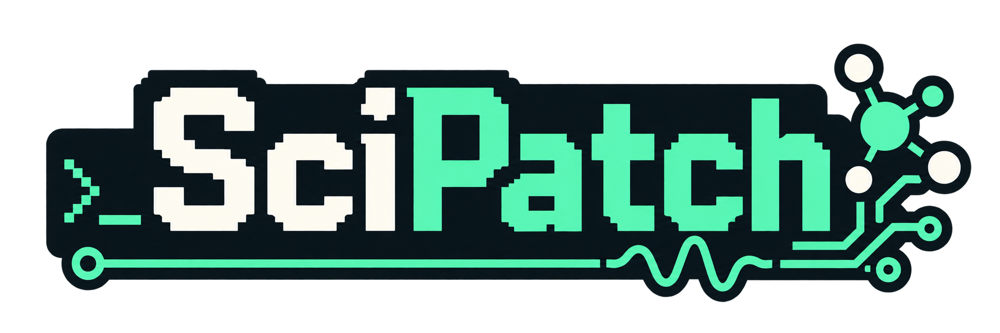
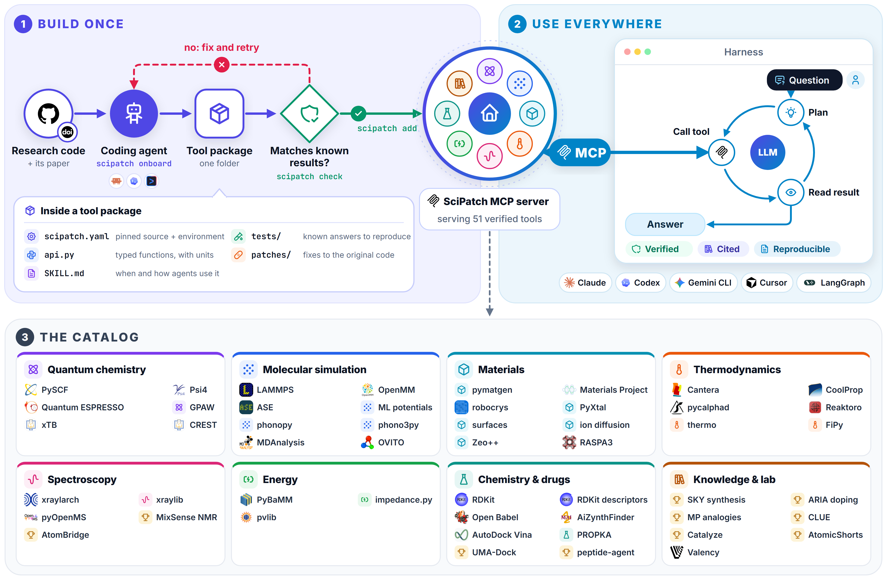

<p align="center">
  
</p>

<h3 align="center">Turn research code into tools that any AI agent can find, run, and remember.</h3>

<p align="center">
  
  
  <a href="https://modelcontextprotocol.io"></a>
  <a href="tools/README.md"></a>
  <a href="LICENSE"></a>
</p>

<p align="center">
  <a href="#quick-start">Quick start</a> •
  <a href="docs/getting-started.md">Getting started</a> •
  <a href="tools/README.md">Tool catalog</a> •
  <a href="docs/onboarding.md">Add your own code</a> •
  <a href="docs/concepts.md">Concepts</a>
</p>

---

SciPatch wraps research code as tools your AI assistant can use. Each tool runs in
its own isolated environment, is checked against published results before it
installs, and is served to Claude, Codex, Gemini CLI, Cursor, and other agents
through **one MCP server**. Ask a scientific question in your AI app: it finds the
right tool, runs it, and answers with units, validity limits, and a citation.
Every run is recorded.

SciPatch is built for materials science and chemistry first, with 50 tools from
DFT and molecular dynamics to docking and X-ray spectroscopy.

## How it works

<p align="center">
  
</p>

1. **Build once.** `scipatch onboard` gives a repository and its paper to your
   coding agent, which wraps it as a tool package. `scipatch check` builds it
   from scratch and confirms it reproduces known results.
2. **Use everywhere.** Every connected AI app reaches the same tools through the
   SciPatch MCP server: the agent plans, calls a tool, reads the result, and answers.
3. **Grow the catalog.** Install verified tools by name, or let your AI app
   install one when it needs it.

## Highlights

- **Isolated environments.** Tools with conflicting dependencies live side by side, each exactly as tested.
- **Verified results.** Golden tests reproduce published or reference values; each tool states its validity limits and citation.
- **Maturity levels.** Tools are *established*, *published*, or *experimental*; agents prefer established ones and cross-check the rest.
- **Run history.** Every run records its inputs, outputs, and exact tool version; identical calls are answered from history.
- **Works with your AI app.** One command connects Claude Desktop, Claude Code, Codex, Gemini CLI, and Cursor.
- **No terminal needed.** `scipatch ui` opens a dashboard with a form for every tool.

## Quick start

**1. Install.** On macOS or Linux:

```bash
git clone https://github.com/MJRaei/SciPatch.git
cd SciPatch
./install.sh
```

On Windows (experimental), in PowerShell:

```powershell
git clone https://github.com/MJRaei/SciPatch.git
cd SciPatch
powershell -ExecutionPolicy ByPass -File install.ps1
```

The installer sets up [uv](https://docs.astral.sh/uv/) (it manages Python for
you), installs SciPatch, and starts the guided setup.

**2. Connect your AI app.** The setup (`scipatch setup`) checks your computer,
connects the AI apps it finds, and offers an example tool. Restart your AI app
afterwards.

**3. Ask a question.** In your AI app:

> *Use my SciPatch tools to find the equilibrium lattice constant and bulk modulus of copper.*

The assistant finds the `ase-emt` tool, runs it, and reports a lattice constant
near 3.59 Å, noting that EMT is an approximate method.

For Windows details and setting up each app by hand, see
[Getting started](docs/getting-started.md).

## Add tools

| To add | Run |
|---|---|
| The SciPatch tool collection | `scipatch catalog add https://github.com/MJRaei/SciPatch` |
| A tool from your catalogs | `scipatch add <name>` (`scipatch catalog` lists them) |
| A tool package (folder or git URL) | `scipatch add ./my-tool` |
| A research repository | `scipatch onboard https://github.com/org/repo --paper <doi>` |

You can also just ask your AI app: when it needs a tool from your catalogs, it
tells you which one and installs it if you agree. Onboarding a repository needs a
coding agent such as [Claude Code](https://claude.com/claude-code), Codex, or
Gemini CLI; see [Turning a repository into a tool](docs/onboarding.md).

## Available tools

| Field | Tools |
|---|---|
| Quantum chemistry | [PySCF](tools/pyscf/), [Psi4](tools/psi4/), [Quantum ESPRESSO](tools/quantum-espresso/), [GPAW](tools/gpaw/), [xTB](tools/xtb/), [CREST](tools/crest/) |
| Molecular simulation | [LAMMPS](tools/lammps/), [OpenMM](tools/openmm/), [ML potentials](tools/ml-potentials/) (Orb, MACE, CHGNet, MatGL), [ASE-EMT](src/scipatch/catalog/ase-emt/), [phonopy](tools/phonopy/), [phono3py](tools/phono3py/), [MDAnalysis](tools/mdanalysis/), [OVITO](tools/ovito/) |
| Materials | [pymatgen](tools/pymatgen-structure/), [Materials Project](tools/materials-project/), [robocrystallographer](tools/robocrys/), [PyXtal](tools/pyxtal/), [surfaces](tools/surfaces/), [ion diffusion](tools/pymatgen-diffusion/), [Zeo++](tools/zeopp/), [RASPA3](tools/raspa3/) |
| Thermodynamics | [Cantera](tools/cantera/), [CoolProp](tools/coolprop/), [pycalphad](tools/pycalphad/), [Reaktoro](tools/reaktoro/), [thermo](tools/thermo/), [FiPy](tools/fipy/) |
| Spectroscopy | [xraylarch](tools/larch/), [xraylib](tools/xraylib/), [pyOpenMS](tools/pyopenms/), [NMR mixtures](tools/nmr-mixtures/), [AtomBridge](tools/atombridge/) |
| Energy | [PyBaMM](tools/pybamm/), [impedance.py](tools/impedance/), [pvlib](tools/pvlib/) |
| Chemistry and drugs | [RDKit](tools/rdkit/), [RDKit descriptors](src/scipatch/catalog/rdkit-descriptors/), [Open Babel](tools/openbabel/), [AiZynthFinder](tools/aizynthfinder/), [AutoDock Vina](tools/vina/), [PROPKA](tools/propka/), [UMA-Dock](tools/umadock/), [peptide assembly](tools/peptide-assembly/) |
| Knowledge and lab | [synthesis recipes](tools/synthesis-recipes/), [doping knowledge](tools/doping-knowledge/), [structural analogs](tools/structural-analogs/), [CLUE](tools/clue/), [Catalyze](tools/catalyze/), [AtomicShorts](tools/atomic-shorts/) |

The [tool catalog](tools/README.md) lists what each tool does, its maturity, the
platforms it runs on, and the results it is checked against.

## Use tools without an AI app

```bash
scipatch ui                                         # dashboard in your browser
scipatch find "lattice constant"                    # search installed tools
scipatch info ase-emt                               # parameters, limits, citation
scipatch run ase-emt equation_of_state element=Cu   # run a function
scipatch runs                                       # past runs
```

Add `--json` to any command for machine-readable output.

## Documentation

- [Getting started](docs/getting-started.md): install on each system and connect each app
- [Concepts](docs/concepts.md): how SciPatch works, and why
- [Turning a repository into a tool](docs/onboarding.md)
- [Tool package format](docs/tool-format.md): `scipatch.yaml`, `api.py`, golden tests, patches
- [Connecting AI apps](docs/connecting-apps.md)
- [Troubleshooting](docs/troubleshooting.md)

## Security

- Installing or onboarding a tool runs code from the repository you choose, as installing it by hand would. Only add code you trust.
- SciPatch's servers listen only on your computer (`127.0.0.1`), and the dashboard requires a per-session token.
- API keys stay on your computer, go only to the tools that declare them, and are entered on a local page, never in the chat.
- SciPatch edits only its own entry in your AI apps' configuration files, and backs them up first.

## Status and contributing

SciPatch is early (version 0.1). Environments are built with uv or conda; Docker
and HPC (Slurm) backends are planned. Issues and pull requests are welcome; see
[Contributing](CONTRIBUTING.md).

## License

[MIT](LICENSE)
