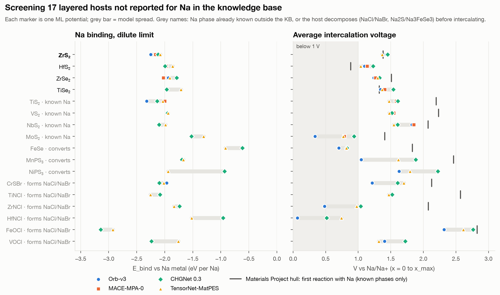
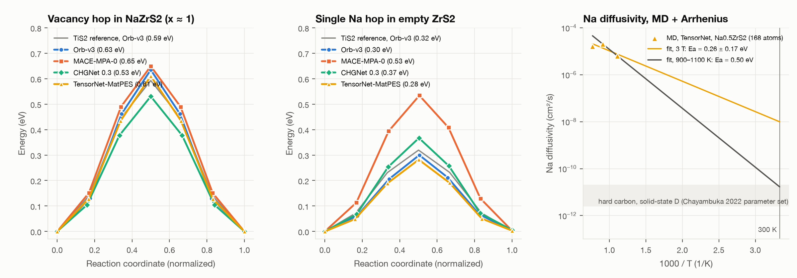
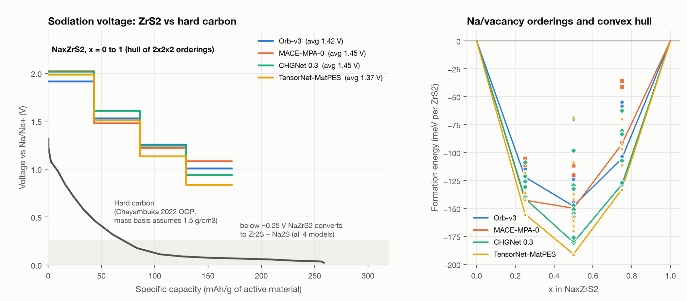
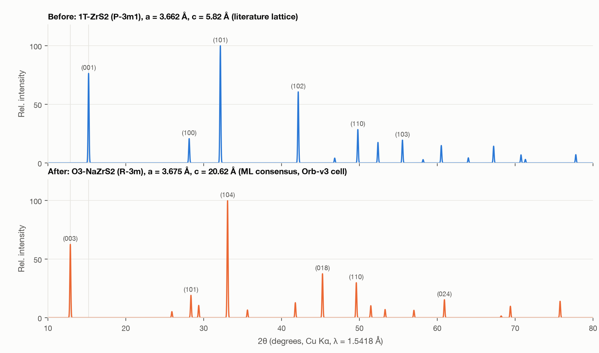
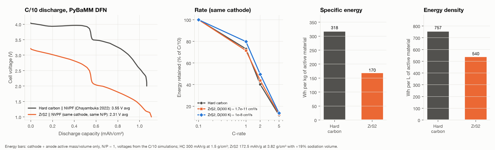
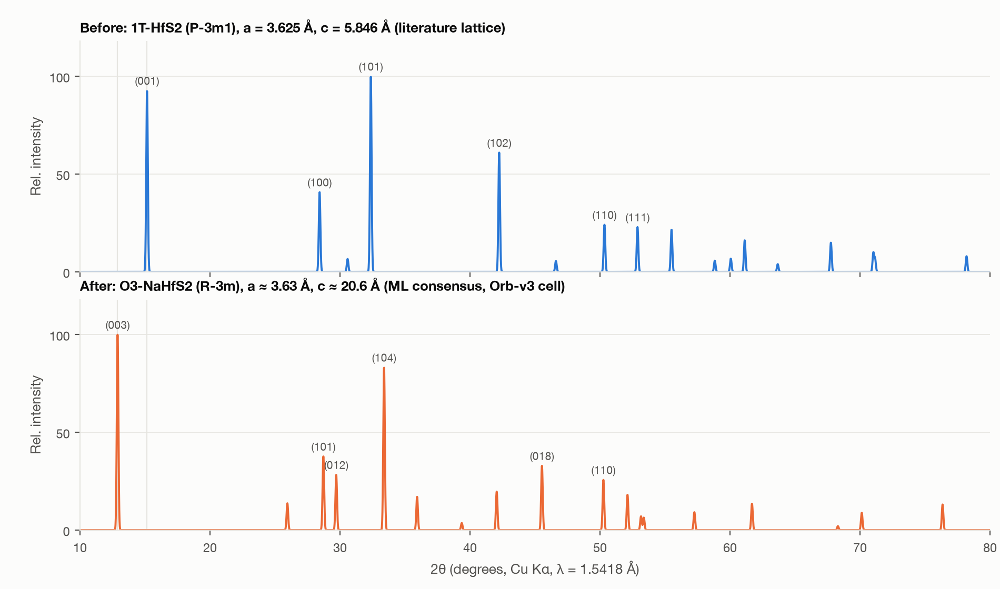

# Example: a new layered host for sodium-ion batteries

One question, answered by an AI agent using SciPatch tools: doping-knowledge, structural-analogs, materials-project, ml-potentials, clue, gpaw, pymatgen-diffusion, pymatgen-structure and pybamm.

## Question

> Find me a new layered material for storing sodium in a sodium-ion battery, one that none of the papers in your knowledge base report for sodium. Rule out what has already been tried, then screen the candidates on four things: how strongly they bind sodium (check that independent ML potentials agree), whether they stay electrically conductive, how fast sodium moves through them, and whether they can be made. For the best candidate, give me a synthesis route, the XRD pattern I should see before and after sodiation, its capacity and average voltage, and how it compares with today's hard-carbon sodium-ion cell. Make plots, and tell me which conclusions are least certain.

## Answer

ZrS₂ is the best layered Na host your knowledge base has no sodium report for, but it is not new to the field. A 2025 Inorganic Chemistry paper (Liers et al.) already shows reversible electrochemical Na intercalation into ZrS₂, forming 3R-NaZrS₂. That paper independently confirms the phase the screen predicted. The best candidate I could find no Na report for at all is HfS₂. It also passes all four checks, but hafnium is far too expensive for a sodium-ion battery.

### Ruling out what's known

The knowledge base (273 papers, an experimental tool) has 13 sodium studies:

- **Na intercalated or adsorbed:** graphite/graphene, SnS₂ (and its graphene hybrids), Cr₂Ge₂Te₆, PdBi₂, hydrogen boride, WSe₂.
- **Na as a constituent:** NaFeAs, NaₓCoO₂, Na titanates.

I excluded all of these and screened 17 other layered hosts.

### Screening (figure 1)

Binding is the dilute-Na energy relative to Na metal. Voltage is the average from empty host to fully sodiated, relative to Na metal.

| Host | Binding (eV per Na, 4 potentials) | Avg. voltage (V) | Capacity (mAh/g) | Verdict |
|---|---|---|---|---|
| ZrS₂ | −2.15 ± 0.06 | 1.42 ± 0.03 | 173 | best |
| HfS₂ | −1.95 ± 0.05 | 1.12 ± 0.07 | 110 | passes; I found no Na report |
| ZrSe₂ | −1.92 ± 0.09 | 1.28 ± 0.03 | 108 | passes; I found no Na report |
| TiS₂ (calibration) | −2.12 ± 0.13 | 1.56 ± 0.05 | 239 | NaTiS₂ already known |
| VS₂, NbS₂, MoS₂ | | | | Na phases already known; NaNbS₂ is a semiconductor |
| ZrNCl, HfNCl, TiNCl, FeOCl, VOCl, CrSBr | | | | decompose to NaCl/NaBr at 2.1–2.8 V |
| FeSe, MnPS₃, NiPS₃ | | | | convert to other compounds before intercalating |

- **Binding agreement:** the four independent ML potentials (Orb-v3, MACE-MPA-0, CHGNet, TensorNet-MatPES) agree within 0.06–0.13 eV on the leading hosts.
- **DFT check:** DFT (GPAW) at the same geometry gives 1.39 V for ZrS₂.
- **Calibration:** the 1.56 V for TiS₂ is close to what I recall for Na/TiS₂ cells (about 1.5–1.7 V); I did not check that experimental number.

### ZrS₂ in detail

**Stays conductive:**

- ZrS₂ itself is a semiconductor: the DFT gap is 1.12 eV, and experiment is about 1.7 eV.
- NaZrS₂ is metallic, per DFT and the CLUE metallicity classifier (vote 0.69).
- Only the first sodiation needs carbon additive in the electrode.

**Stable (can be made):**

- ZrS₂ is commercial, listed in ICSD, and on the Materials Project convex hull.
- All four potentials put NaZrS₂ 18–46 meV/atom below its best decomposition (Na₁₉Zr₁₁S₃₀ + ZrS).
- It stays intact down to about 0.25 V versus Na.

**Sodium transport:**

- The barrier to hop into a vacancy is 0.53–0.65 eV; a lone Na in the empty host hops over 0.28–0.53 eV. Both are about the same as TiS₂ (0.59 / 0.32 eV).
- MD at 1100 K gives D = 2.0 × 10⁻⁵ cm²/s.
- Extrapolated to room temperature, D is 10⁻¹¹ to 10⁻⁸ cm²/s, at or above hard carbon's.

**Capacity:** 172.5 mAh/g theoretical, about 550 mAh/cm³ counting the sodiated volume.

**Voltage:** averages 1.42 V. The curve steps down from about 2.0 to 0.95 V (figure 2), all above the Na-plating region.

**Volume change:** interlayer spacing goes from 5.82 to about 6.88 Å (+18%); the in-plane lattice is nearly unchanged.

### Synthesis route

1. **Make ZrS₂:** buy it, or react Zr + 2.05 S in an evacuated quartz ampoule. Hold at 450 °C first so sulfur doesn't over-pressurise the ampoule, then 800–900 °C for 2–3 days. For crystals, use iodine vapour transport, the route the knowledge base reports for ZrSe₂ and ZrTe₃.
2. **Sodiate electrochemically (recommended):**
   - Electrode: ZrS₂ / carbon black / PVDF at 80:10:10 on aluminium foil, against Na metal.
   - Electrolyte: 1 M NaPF₆ in EC:DEC. Avoid diglyme: the 2025 paper saw solvent co-intercalate and the layers lose their ordering.
   - Cycle at C/20 between 2.4 and 0.5 V. Don't go below about 0.3 V, where the compound converts.
3. **Or sodiate chemically:** about 1.05 equivalents of sodium naphthalenide in THF at room temperature, then dry under vacuum. Alternatively, use Na in liquid ammonia at −50 °C (the knowledge base's Cr₂Ge₂Te₆ route), then pump off the ammonia.
4. **Avoid direct high-temperature synthesis:** the stability margin is small, so you'd likely get mixed phases.
5. **Handle NaZrS₂ in a glovebox:** moisture releases H₂S.

### XRD, Cu Kα (figure 3)

| | Main peaks, 2θ (hkl) |
|---|---|
| Before: 1T-ZrS₂ | 15.2° (001, d = 5.82 Å), 28.1° (100), 32.1° (101, strongest), 42.1° (102), 49.8° (110) |
| After: O3-NaZrS₂ (R-3m, a = 3.675 Å, c = 20.62 Å) | 12.9° (003, d = 6.87 Å), 28.4° (101), 29.4° (012), 33.1° (104, strongest), 45.3° (018), 49.6° (110) |

The signature of sodiation is the 15.2° peak giving way to one at about 12.9°, while (110) stays near 49.7°. The 12.9° position could plausibly sit anywhere in 12.9–13.2°.

### Against today's hard-carbon cell (figure 5)

The baseline is the Chayambuka 2022 hard-carbon / Na₃V₂(PO₄)₂F₃ cell in PyBaMM. I swapped in a ZrS₂ negative electrode with the same cathode and the same capacity ratio.

| | Hard carbon | ZrS₂ |
|---|---|---|
| Average cell voltage (C/10) | 3.55 V | 2.31 V |
| Cell energy (C/10, same areal capacity) | 100% | 68–69% |
| Negative-electrode thickness | 64 µm | 38 µm |
| Active-material specific energy | 318 Wh/kg | 170 Wh/kg |
| Active-material energy density | 757 Wh/L | 540 Wh/L |
| Rate capability | similar | similar |

Rate is set by the shared cathode and electrolyte in this cell. ZrS₂ does not replace hard carbon for energy. Its case would be safety and power: no Na plating, a metallic sodiated state and a thin electrode, at the cost of zirconium and sulfide moisture sensitivity.

### HfS₂, the unreported alternative

It would give a higher cell voltage (1.12 V versus Na) and similar volumetric capacity, and NaHfS₂ stays stable down to about 0.2–0.37 V. Its vacancy-hop barrier is 0.61 eV (one potential). The (003) peak lands at 12.9°, against HfS₂'s (001) at 15.2°. Only two of the four potentials ran its full voltage curve, and it has had no DFT or MD.

### Least certain conclusions, most uncertain first

1. **Novelty:** the HfS₂/ZrSe₂ check was a quick web search, not a systematic literature review.
2. **Room-temperature Na diffusivity:** it spans three orders of magnitude. The MD is short (5–11 ps), at 900–1300 K, at half sodiation, and with one potential.
3. **Volume change and the sodiated XRD:** none of the potentials include van der Waals forces, so they over-swell the empty host. I used the literature lattice for pristine ZrS₂ (5.82 Å).
4. **The 18–46 meV/atom stability margin:** it is about the size of ML error. The 2025 experiment supports it.
5. **Voltage curve shape:** it comes from a coarse set of Na arrangements, so treat it as ±0.1–0.2 V.
6. **Practical capacity:** real reversible capacity is probably below the 172.5 mAh/g theoretical value.
7. **Cell rate results:** ZrS₂'s reaction kinetics and particle size were copied from hard carbon. The energy gap is robust because it is set by voltage.

The most solid results are the binding strengths (four potentials plus DFT agree), the elimination of the halide and conversion hosts (large thermodynamic margins), and the fact that ZrS₂ can be made.

### Runs and citations

Key SciPatch runs:

- Knowledge-base Na query: `20261022-115712-f93693`
- GPAW: `20261022-134544-8d923b` (NaZrS₂), `20261022-134849-e85f49` (ZrS₂), `20261022-135316-1c192e` (Na)
- Arrhenius fit: `20261022-143823-9ee81a`
- XRD: `20261022-130704-74ad21` (ZrS₂), `20261022-134350-fe5464` (NaZrS₂)

Cite as: Orb-v3 (arXiv:2504.06231), MACE-MP (arXiv:2401.00096), CHGNet (Nat. Mach. Intell. 2023), TensorNet/MatPES (arXiv:2503.04070), GPAW (J. Chem. Phys. 160, 092503, 2024), PyBaMM (J. Open Res. Softw. 2021) with Chayambuka et al. (Electrochim. Acta 404, 139764, 2022), and Materials Project (database 2026.09.28).

Sources:

- Liers et al. 2025, Na intercalation into ZrS₂ (PMC)
- Graphene–HfS₂ heterostructure DFT study (arXiv)
- Alkali-metal intercalated ZrSe₂ (KIT)
- ZrS₂ as a Li-ion electrode (Sookmyung)

## What's in this folder

| Folder | Contents |
|---|---|
| [plots/](plots/) | The six figures above |
| [data/hosts](data/hosts), [data/structs](data/structs), [data/mp](data/mp) | Candidate hosts, their structures, and Materials Project lookups |
| [data/relax](data/relax), [data/enum](data/enum) | ML-potential relaxations and Na arrangements for the voltage curves |
| [data/clue](data/clue) | Metallicity predictions |
| [data/dft](data/dft) | GPAW checks |
| [data/neb](data/neb), [data/md](data/md) | Na hop barriers and molecular dynamics trajectories |
| [data/xrd](data/xrd) | Simulated XRD patterns (CSV) and the structures used |
| [data/pybamm](data/pybamm) | Cell simulations against the hard-carbon baseline |
| [scripts/](scripts/) | The scripts the agent wrote to drive the runs and make the figures |

The scripts were run from a temporary working folder, so the paths inside them point there and they won't run from this folder as-is.
